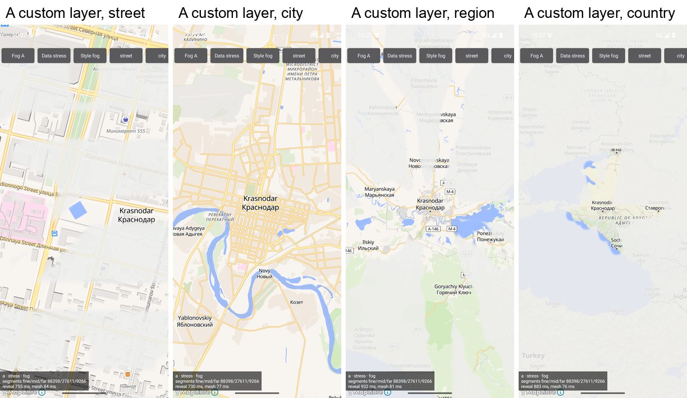
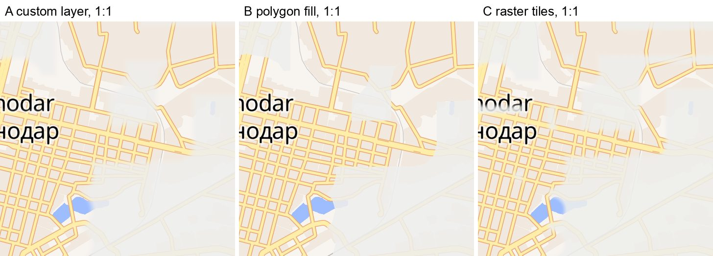
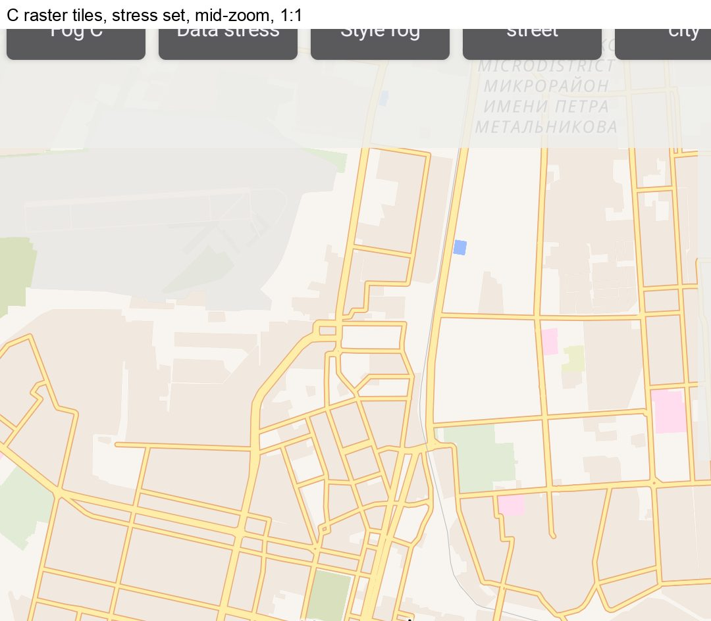
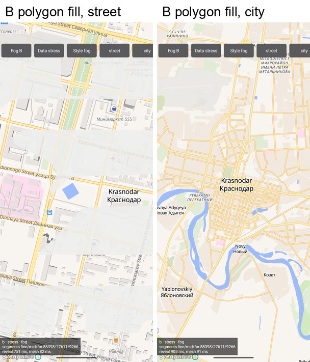
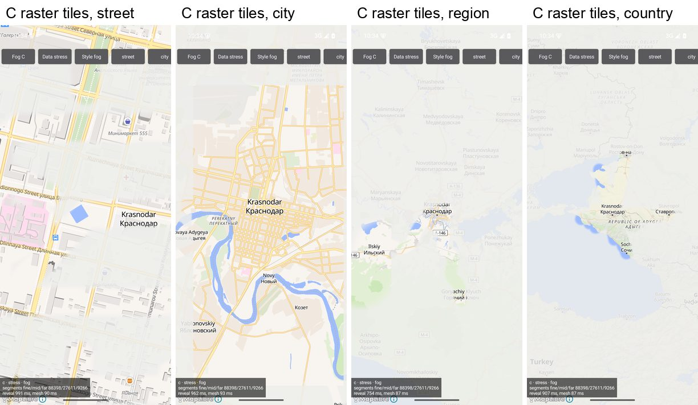
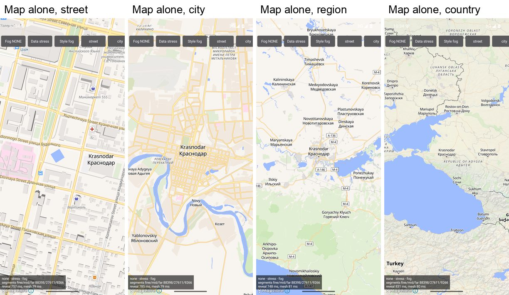
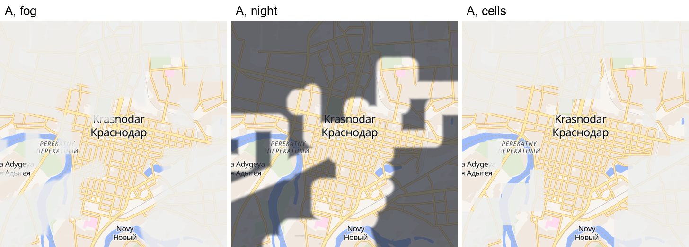
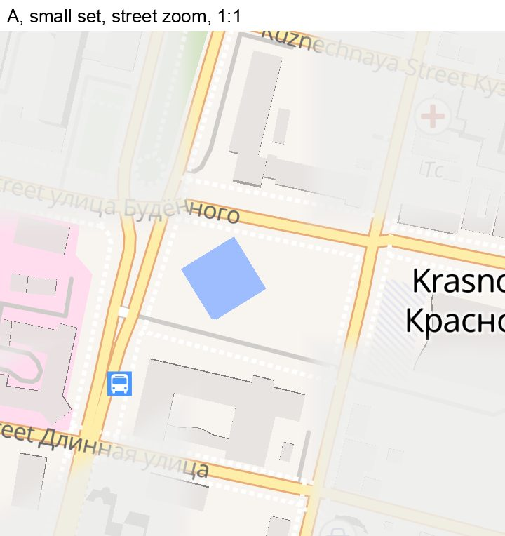

# Atlas fog on Android

Spike of 30 October 2026, branch `w0-fog-spike`. The prototype is in `spikes/fog/`, raw bench
results and screenshots are in `docs/assets/fog-spike/`.

## Decision

The map is MapLibre Native for Android, the OpenGL ES build (`org.maplibre.gl:android-sdk-opengl`
13.7.1), with OpenFreeMap vector tiles. The fog is a native custom layer: a small C++ library that
MapLibre calls inside its own frame and that runs the two passes of the iPhone 0.8.0 Metal fog,
ported to GLES 3.0 (candidate A below).

A is the only candidate that keeps the reference picture by construction. MapLibre draws the fog
in the same frame and with the same camera as the tiles, so the fog cannot lag behind the
fingers. The fog is rebuilt from road segments on every frame, which leaves nothing to stretch,
reload or cut into tiles. On the emulator it costs 0.07-0.22 ms of CPU per frame at the median
and keeps the frame rate within noise of the map alone, also with 88,000 revealed segments.

The open question is GPU fill on real phones. A dense library makes the coverage pass shade
hundreds of millions of fragments per frame, and the emulator's Mac GPU hides that cost. The APK
(`spikes/fog/out/fog-spike.apk`, see `spikes/fog/README.md`) measures it on any phone; the known
fixes are under Risks.

## The bar

From the iPhone `CLAUDE.md` (sections on the fog, the Metal fog, halo and clouds, and the cells
style) and `TripTrack/Views/MyMap/FogMetal/`:

- the fog is rebuilt every frame on the GPU and stays glued to the map in pinch, zoom and pan;
- one flat colour times alpha: mist `#EEEEEC` × 0.87, night `#262B36` × 0.70;
- corridor half-width max(50 m, 18 pt × metres per point), feather 0.4 × half-width cut inward;
- overlapping corridors merge by max (no beads at joints), the composite is premultiplied;
- three levels of detail by zoom, Float32 precision handled with 32,768 map point chunks, no tilt.

Rejected before on the iPhone: a raster drawn for 2× the screen and moved by an affine transform
during gestures (blur on pinch, a visible reload after it, squares at the edges), and fog presented
out of step with the tiles, which "floats behind the fingers".

## Candidates

| | How the fog is drawn | Moves with the map | Sharp during pinch | Feather and max union | Cost of new geometry | Verdict |
|---|---|---|---|---|---|---|
| A | MapLibre custom layer, C++ host, GLES 3.0: segments → coverage texture → composite, every frame | yes, same frame and camera | yes | yes, the iPhone shader math | one upload: 2 MB in 2.9 ms | chosen |
| B | MapLibre fill layer: the world as one polygon with the corridors cut out, buffered with JTS per zoom band | yes | edges yes, width no: holes scale inside a band and jump at its edge | no feather possible; union exact | 1.1-3.0 s per band on the stress set | rejected |
| C | MapLibre raster source: fog tiles drawn on the phone with A's math, served through an OkHttp interceptor | yes | no: tiles are scaled between zoom levels, then replaced with a fade | yes inside a tile | 1.2 s median per tile on the stress set, up to 14 s | rejected |
| D | Google Maps SDK | - | - | - | - | not built |

Not built:

- Google Maps SDK (D) has no way to draw inside the map's frame on Android. It offers markers,
  polylines, polygons with holes, circles, ground overlays and tile overlays, and the JavaScript
  API's `WebGLOverlayView` has no Android counterpart. The fog could only be what B or C measure,
  a ground overlay (one image per camera, the raster the owner rejected), or a separate GL view
  following camera callbacks. That last one is the "floats behind the fingers" problem: Google
  renders on its own thread and reports the camera to the main thread afterwards. The SDK also
  needs an API key in a project with billing enabled, which the owner cannot open; see Money.
- A heatmap layer (MapLibre's own offscreen density pass, coloured from fog to clear) gives soft
  edges with style layers alone. Its density adds up where corridors overlap, though, so every
  crossing and every overlap of two drives gets a wider hole: the beads the max union exists to
  prevent. Its radius is in pixels, so the 50 m floor only works for one latitude.
- Mapbox Maps SDK has a Kotlin custom layer API. It needs an account with a payment card and bills
  per monthly active user beyond a free tier (25,000 MAU according to third-party price summaries
  of October 2026), so it runs into the same card problem as Google.
- A transparent GL view over the map, redrawn on camera callbacks, is the out-of-step design the
  owner rejected on the iPhone.

## Measurements

Setup: Android emulator, API 35 arm64 image, Pixel 7 profile (1080 × 2400, density 2.625), host
GPU through the emulator's GLES 3.0 translator on an Apple M2 Pro. The android-36 image the brief
mentions was an empty, failed install, so the runs used API 35; the app targets SDK 36. Other
agents were building on the same machine the whole time: load average 18-31 on 12 cores, logged
per run in the raw results.

Data, all around Krasnodar, run through a trimmed port of the iPhone reveal builder
(`RevealLite.kt`: 75 m cells, "claim and cut", three levels at 45 m, 250 m and 1 km):

| Dataset | Trips × points | Segments fine / mid / far | Mesh | Reveal build | Mesh build |
|---|---|---|---|---|---|
| small: ten drives through town, two out of town | 12, 13,195 points | 3,047 / 938 / 286 | 67 KB | 230-320 ms | 23-61 ms |
| stress: 360 drives through town, 40 to towns up to 300 km away | 400 × 2,000 | 88,398 / 27,611 / 9,266 | 2.0 MB | 0.75-1.1 s | 68-122 ms |
| ios: the iPhone `-seed-hang-stress` formula | 400 × 2,000 | 35,905 / 11,873 / 3,667 | 0.8 MB | 1.05 s | 39 ms |

The `ios` row checks the port against the iPhone: 51,445 segments in total where the iPhone docs
give 51,444, 267 far chunks where they give 267, 0.8 MB of mesh where they give 0.8 MB, and a mesh
build of 39 ms where the iPhone simulator measured 63 ms. Uploading the 2 MB stress mesh to the GPU
takes 2.9 ms on the GL thread.

The bench (`BenchRunner.kt`) injects touch events into the map view once per display frame, so
MapLibre's own gesture code runs as it does under a finger. Pan is one finger tracing two circles
for 4.5 s. Pinch is two fingers swinging in and out three times for 4.5 s without lifting, about
1.7 zoom levels each way. Zoom is a chain of camera animations from zoom 12 to 5, then to 15.5,
then to 12, across all three levels of detail. A frame is timed when MapLibre calls the custom
layer, once per map frame on its GL thread; B, C and the bare map get an empty probe layer for
that. The camera keeps moving through every phase, so a gap between frames is a slow frame and
never a finger at rest.

Frame cadence, median of three interleaved rounds (fps · 95th percentile frame interval in ms):

| Phase | Map alone | A | B | C |
|---|---|---|---|---|
| small, pan | 52 · 25.8 | 52 · 26.7 | 51 · 27.8 | 50 · 28.3 |
| small, pinch | 45 · 33.1 | 44 · 33.5 | 45 · 35.0 | 39 · 39.5 |
| small, zoom | 56 · 25.6 | 55 · 28.9 | 54 · 29.7 | 54 · 30.0 |
| stress, pan | 52 · 25.9 | 52 · 25.7 | 51 · 26.6 | 45 · 38.3 |
| stress, pinch | 45 · 35.2 | 42 · 36.0 | 45 · 34.4 | 36 · 51.1 |
| stress, zoom | 54 · 28.7 | 51 · 30.8 | 54 · 29.7 | 54 · 29.6 |

The emulator does not hold 60 fps even for the bare map (MapLibre spends 15-20 ms of CPU per frame
in pan and pinch here), and the same configuration varies by 5-10 fps between runs on this loaded
host. A stays within that noise of the map alone, and C drops frames; the absolute numbers say
little about a phone. B's frames are cheap because its fog is one fill layer. Its trouble is the
geometry.

What each candidate spends to produce its fog:

- A encodes a frame on the GL thread (all GL calls except the two state queries) in 0.07-0.22 ms
  at the median and 0.18-0.64 ms at the 95th percentile. The zoom phase on the stress set was the
  exception at 9.2 ms, from about 900 chunks per level at one draw call each. With 2^20 map point
  chunks for the mid and far levels (9 chunks each) it drops to 0.53-0.56 ms. The two state
  queries add 0.5-0.6 ms at the median on the emulator, where every query is a round trip to the
  host GPU; on a phone they read driver state.
- B buffers and unions with JTS per zoom band on a worker thread: 15-120 ms on the small set and
  1.1-3.0 s on the stress set (11,000-14,000 vertices in, up to 40,000 out, GeoJSON up to 0.9 MB).
  In the zoom phase most builds were stale by the time they finished, so the fog showed the wrong
  band's corridors for seconds. Java heap reached 230 MB.
- C draws a 512 px tile on an OkHttp thread in 16 ms at the median and 0.7 s at the 95th
  percentile on the small set. On the stress set it takes 1.2 s at the median, 2.4 s at the 95th
  percentile and 14 s at worst, plus 24-87 ms of PNG encoding. Until a tile arrives MapLibre shows
  the map there without fog.

Memory, process PSS at the end of a run (median of three): the bare map 139-143 MB, A 139-140 MB,
B 136 MB on the small set and 369 MB on the stress set, C 236-244 MB. A's GPU memory, which the
emulator does not report, is the mesh (2.0 MB for the stress set) plus the coverage texture
(2.6 MB at 1080 × 2400).

The cost the emulator cannot show is GPU fill. The coverage pass draws a quad of 2 × (half-width +
feather), about 50 points, around every segment, and fine segments are 45 m apart, so at city zoom
about 15 quads cover each pixel of a road. Estimated fragments per frame on the stress set at the
95th percentile: pan 280 million, pinch 517 million, zoom 501-555 million, and 722 million in the
worst frame. The M2 Pro behind the emulator absorbs that; a mid-range phone GPU may not. The spike
APK has a half-resolution coverage option (`Cov half`) that divides this by four (70, 129 and
139-143 million, worst frame 180 million) and samples the coverage bilinearly, on an edge that
already has a 7-17 point feather. On phones whose driver has `GL_EXT_disjoint_timer_query` the
APK reports GPU time per frame.

## Screenshots

Emulator frames with the mist palette. Full frames are scaled to 300 px wide; crops are 1:1.

A on the stress set at street, city, region and country zoom. At street zoom the 50 m floor keeps
fog between blocks; further out the 18 point halo turns the town into a patch and roads into
bands:

The same corridors at rest on the small set, 1:1. A fades inward over the feather. B's polygon
edge is hard, and holes cut at the full half-width look wider. C rasterises A's math into tiles,
so at rest it matches A:

C in the middle of a zoom on the stress set. Fog arrives tile by tile, so the frame has straight
tile borders between fogged tiles and tiles not drawn yet. These are the squares the owner
rejected on the iPhone, and here a tile takes over a second to draw:

B and C at the four zooms on the stress set. B has only street and city: at region zoom the JTS
union ran out of the 576 MB large heap and the app crashed.

The map alone, for reference:

A's three styles on the small set: fog (mist), night (slate), and cells, which quantises the same
coverage into squares anchored to the world:

A at street zoom on the small set, 1:1:

The mid-zoom frames come from a slow camera zoom animation. A slow injected pinch did not start
MapLibre's scale gesture; the fast pinch of the bench did, so the frame times above come from real
pinch gestures.

## How A works

Code: `spikes/fog/app/src/main/cpp/fog_layer.cpp` (the layer), `FogMesh.kt` (chunks),
`FogRules.kt` (the numbers), `CustomLayerFog` in `FogCandidate.kt` (the Kotlin side).

- `CustomLayer(id, host)` takes a pointer to a C++ `mln::style::CustomLayerHost`. MapLibre calls
  `render()` once per frame on its GL thread, between its own layers, with the camera of the frame
  it is drawing. The fog is the top layer, so it covers labels too, as on the iPhone. MapLibre's
  logo and attribution are Android views above the map and stay readable without the carve window
  iOS needed.
- `render()` runs the two passes of `FogShaders.metal` in GLSL ES 3.00. The coverage pass draws one
  instance per segment, a capsule quad in screen points with `1 − smoothstep(hw − feather, hw, d)`,
  into an R8 texture the size of the framebuffer with `GL_MAX` blending. The composite pass draws
  one full-screen triangle with `a = alpha × (1 − coverage)`, premultiplied, blended
  `ONE, ONE_MINUS_SRC_ALPHA` into MapLibre's framebuffer, and samples the coverage at the same
  pixel with nearest filtering.
- The map point → screen point frame comes from MapLibre's projection matrix: the camera centre and
  two points 256 points away, projected in double. Without pitch the ground plane projects
  affinely, so three points define it exactly, and rotation and map padding need no extra code.
  The camera centre lands on the viewport centre to 2e-10 points, which confirms the world units.
- Segments live in 32,768 map point chunks as Float32 offsets from the chunk origin, and the
  chunk's screen position is computed in double on the CPU, as on iOS. The mid and far levels use
  2^20 map point chunks instead (Android only, see Measurements): a draw call per chunk costs more
  on GL than on Metal, and Float32 inside such a chunk is still precise to under a thousandth of a
  screen point at those zooms.
- Half-width, feather, LOD thresholds and chunk sizes live in one Kotlin object (`FogRules`) and
  reach the native side once. The level of detail is picked from screen points per map point with
  the iPhone thresholds (fine above 1.5e-3, mid above 1.5e-4).
- The three LOD buffers are built off the main thread and swapped together, so a frame never mixes
  a new fine level with an old far one. MapLibre renders only when something changes, so a map at
  rest costs nothing; iOS needed its own display link logic for that.
- MapLibre re-applies its GL state and rebinds its framebuffer after `render()`. The layer still
  asks which framebuffer and viewport it found, because the composite has to go back into
  MapLibre's framebuffer.
- `FogCellGrid` is ported into the composite pass only, so with cells off the coverage pass is the
  plain fog, as on iOS.
- Tilt gestures are off and the maximum pitch is 0.
- Not in the spike: the live reveal circle around the car (one uniform, as in the iPhone shader),
  the 0.25 s style crossfade, and testing of context-loss recovery.

## Risks

- The host is C++ written against headers MapLibre does not publish. The AAR ships no headers, so
  the spike mirrors `CustomLayerHost` and `CustomLayerRenderParameters` from the tag
  `android-v13.7.1` in `mln_custom_layer_host.hpp`. If a MapLibre upgrade reorders the virtual
  methods or the parameters, the app crashes on the first frame and no compiler notices. This has
  happened before: the namespace moved from `mbgl` to `mln` and `initialize()` gained a parameter.
  Pin the MapLibre version, compare the three headers with each upgrade, and keep an instrumented
  test that draws one frame and reads the pixels back. On 29 October 2026 MapLibre relabelled
  custom layers from "experimental" to an "advanced feature" (maplibre-native PR #4881). A C plugin
  API with a stable ABI ships in the `-with-plugin-api` artifacts since 13.7.0, still marked
  experimental; it is the way out if the C++ mirror becomes a burden.
- MapLibre's default is now Vulkan. Since 13.0 the plain `android-sdk` artifact is Vulkan only. The
  OpenGL ES artifact gets the same releases and runs on every phone (the Wikipedia app moved back
  to it on 7 October 2026 because Vulkan-only builds cannot be installed on some low-end phones),
  and no end date is announced. If OpenGL ES is ever dropped, the two passes have to be rewritten
  for Vulkan in C++; MapLibre already passes Vulkan handles to custom layers.
- GPU fill on mid-range phones. Every segment gets a quad about 50 points wide and fine segments
  are 45 m apart, so at city zoom each road pixel is shaded about 15 times. On the stress set that
  is 280-555 million fragments per frame at the 95th percentile. The owner accepted the same
  design on an iPhone 17 Pro Max; mid-range Android GPUs have far less fill rate. Fixes, cheapest
  first: coverage at half resolution (in the APK, 4× fewer fragments, on an already soft edge);
  more levels of detail, picked so that segments are not much shorter on screen than the corridor
  is wide (fewer quads overlapping less, the line moving by under a point); and the coarse chunks
  already in the spike for the CPU side. Each is a divergence from the iPhone's numbers and goes
  into `docs/divergences.md` when adopted.
- Emulator numbers are not phone numbers. The emulator draws through the Mac's GPU (Apple M2 Pro
  behind a GLES 3.0 translator), every GL query is a round trip to the host, and there is no GPU
  timer. The host was also busy, with a load average of 18-31 on 12 cores during the runs. The CPU
  cost per frame and the order of the candidates hold; GPU time needs a real phone. The spike APK
  records it where `GL_EXT_disjoint_timer_query` exists (most Adreno and Mali GPUs).
- OpenFreeMap is a free service without an SLA, funded by donations. If it degrades or gets
  blocked for some users, the style URL changes to another host with the OpenMapTiles schema or to
  our own tiles (OpenFreeMap publishes weekly planet files and its full setup). Reachability from
  Russian networks was not tested from here.
- Context loss is handled in code (the layer forgets its GL objects, MapLibre calls `initialize()`
  again, and the mesh is uploaded from the state Kotlin keeps) but was not exercised.
- The coverage texture takes one byte per framebuffer pixel: 2.6 MB on a 1080 × 2400 screen, on
  top of the mesh (1.96 MB for the 88,000 segment stress set).

## Money

| Stack | Cost | What it needs |
|---|---|---|
| MapLibre + OpenFreeMap (chosen) | 0 | Nothing. No key, no account, no limits on map views; attribution, which MapLibre shows by itself. Donations are welcome. |
| MapLibre + own tiles | a server or object storage | Someone to run it. The fallback if OpenFreeMap goes away. |
| Google Maps SDK | 0 per map load: the "Maps SDK" SKU is listed as unlimited and free | An API key in a Cloud project with billing enabled. Google Cloud paused new sign-ups for users in Russia on 10 March 2022, and its billing page still says so (updated 26 October 2026). A foreign company or card would be needed. |
| Mapbox | free up to a monthly active user limit, then per user | An account with a payment card: the same problem. |

MapLibre Native is BSD-2-Clause, OpenFreeMap's code is MIT, and the map data is © OpenStreetMap
contributors (ODbL) via OpenMapTiles.

## For the port

- `core/map` gets the native layer, built with the NDK (CMake, `c++_static`, 16 KB pages), with
  the Kotlin `FogRules` and mesh builder next to it. NDK 28 aligns to 16 KB and MapLibre's own
  library is aligned too, so the Play rule for Android 15+ is met.
- Use `android-sdk-opengl`, pinned, and the header mirror with a comment naming the tag.
- The trimmed reveal builder of the spike (`RevealLite.kt`) reproduces the iPhone mesh on the
  iPhone stress seed (51,445 segments against 51,444 in the iPhone docs). The real port of
  `RevealBuilder`, `RevealGrid` and `RevealedLayer` comes with their tests in wave 2.
- `FogMetalPixelTests`, `FogMetalCarveTests` and `FogMeshSignatureTests` need GL, so they become
  instrumented tests that render one frame offscreen and read pixels back. The math (`FogRules`,
  chunking, the affine frame, `FogCellGrid`) stays in JVM unit tests.
- Try the spike APK on a real phone before wave 2. A Samsung or a Xiaomi with Adreno or Mali gives
  the GPU time per frame that the emulator cannot. Bench with `Data stress`, once with `Cov full`
  and once with `Cov half`; the summary line shows GPU p50 and p95.
- Pick the fill fixes from that run, and record whichever is adopted in `docs/divergences.md`
  together with the coarse mid and far chunks.
- Not ported yet: the live reveal circle, the style crossfade, the poster (`FogOffscreen`).
