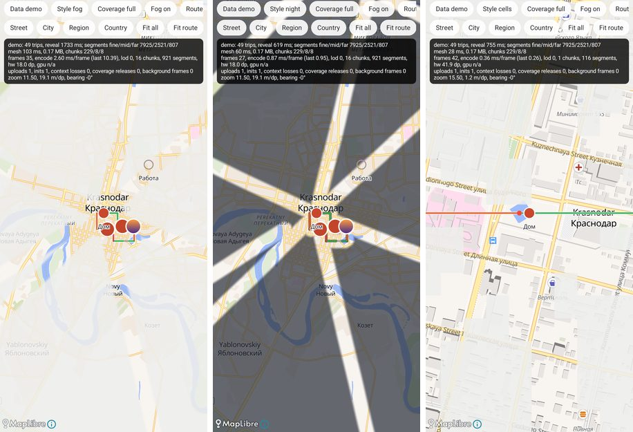
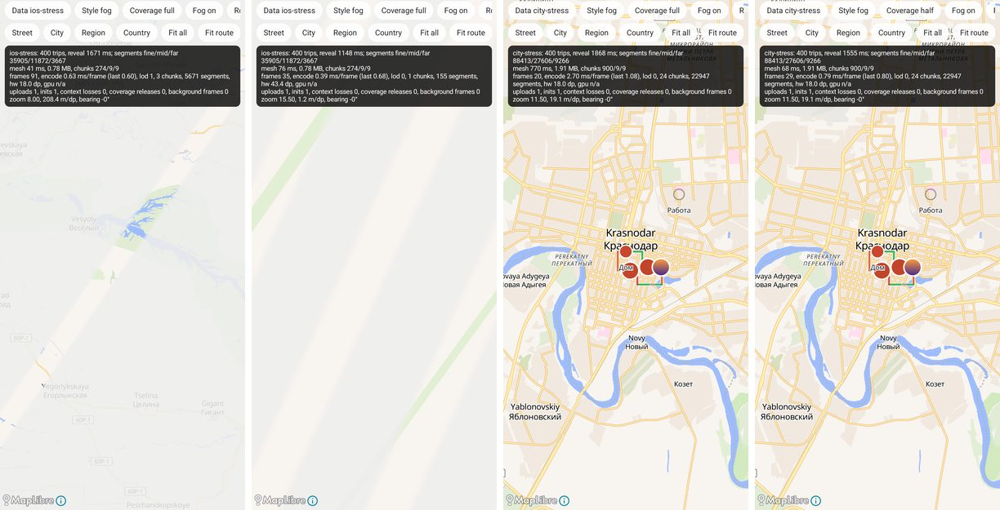
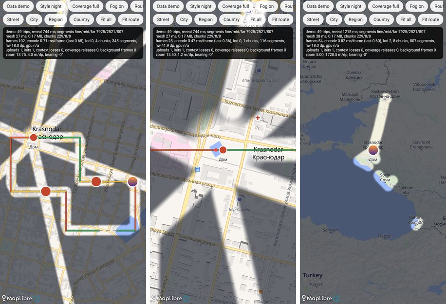

# w2-map: report

Branch `w2-map`. `core:map` is the production map: MapLibre Native (OpenGL ES build, pinned 13.7.1)
with OpenFreeMap tiles, the Atlas fog as a C++ custom layer inside MapLibre's frame, speed-coloured
routes, simple markers, iOS camera framing, and a Compose `MapHost`. A debug-only demo screen shows
it over seeded libraries, including the iPhone stress set (400 trips × 2,000 points).

## What was built

| Android | iOS |
|---|---|
| `core/map/src/main/cpp/fog_layer.cpp`, `fog_frame.hpp`, `fog_state.hpp`, `fog_jni.cpp` | `FogShaders.metal` (both passes, cells, live reveal), `FogFrameEncoder.swift`, `FogMetalVeil.swift` (frame numbers, background and memory rules), `FogCellGrid.make`, `FogRevealCircle.swift` |
| `fog/FogLayer.kt` (mesh build off the main thread, newest wins; look; reveal; lifecycle; stats) | `FogMetalVeil.swift` (`setLayer`, `meshToken`, `setUsesCells` with one frame per style, `setLiveReveal`, background, memory warning) |
| `fog/FogMesh.kt` (`FogMesh`, `FogMeshLod`, `FogMeshSignature`) | `FogMesh.swift` (`FogChunk`, `build`, `signature`, `byteSize`, `chunkCount`) |
| `fog/FogRules.kt` | `FogMetalVeil.featherRatio`, `FogMesh.chunkSize`, `FogVeilRenderer.lod` thresholds and `revealMetres`, `VeilRevealMask.solidFraction`; corridor and cell numbers come from `core:logic` (`FogVeilRenderer`, `FogCellGrid`) |
| `fog/FogLook.kt` | `FogVeilPainter.Palette` (`.mist` #EEEEEC × 0.87, `.night` #262B36 × 0.70), `AtlasMapAppearance.usesDarkFog` / `usesCells` |
| `fog/MapLibreAbi.kt`, `maplibre-abi.properties`, `verifyMapLibreAbi` task | (Android only: the ABI pin) |
| `route/RouteGeometry.kt`, `route/SpeedColorScale.kt`, `route/RouteAppearance.kt`, `route/RouteLayers.kt` | `RouteMapView` (`splitIntoSegments`, `splitByKnownSpeed`, `simplifyWithSpeeds`, `groupBySpeedZone`, `drawEpsilon`, unknown-speed dash, start/end dots, `routeRenderer`), `SpeedColorScale.swift`, `CasedPolylineRenderer`, `RouteVeinRenderer.selectedWidth/casingExtra/resolvedColors` |
| `camera/MapCameraCommand.kt`, `camera/CameraFraming.kt` | `MapCameraCommand` and `Padding.insets` (`MyMapViewModel.swift`), `GeoBounds.mapRect` (300 m floor), `RouteMapView.floored` (400 m) and `defaultFitInsets` |
| `marker/MapMarker.kt`, `marker/MarkerLayers.kt` | `PlacePinView` sizes and colours, the compact checkpoint marker, `PhotoAnnotation`, the 44 pt touch target of the Atlas pins |
| `MapHost.kt`, `MapHostState.kt`, `MapController.kt`, `MapPoints.kt` | `MyMapRepresentable` / `RouteMapView` hosting rules: no pitch, rotation kept, attribution visible, camera only after layout |
| `core:logic` `RevealBuilder.kt` (`TilePatch`, `patches`, `neighbourClaimed`, `tileLine`, the in-memory `layer`) | `RevealBuilder.swift`, the in-memory branch of `RevealedLayerStore.layer(before:)` |
| `core:logic` `RouteSimplification.kt` (`splitByGaps`, `simplifyRDP`, `simplifyIndices`, `polylineLength`, `perpendicularDistance`, `defaultGapThreshold`) | `GeometryUtils.swift` |
| `app/src/debug`: `MapDemoActivity`, `MapDemoSeeds`, debug strings, a second launcher entry | `DebugMapSeed` (`-seed-map-demo` routes, `-seed-hang-stress`), the spike's dense city set |

`RevealBuilder` and the route geometry were not in `core:logic` yet. The demo needs the first to
show the stress set at its real size (claim and cut turns 800,000 raw segments into 51,444), and the
second is the render-time simplification the route drawing is specified by. Both are pure ports with
their iOS tests; nothing in `core:logic` was duplicated, and `RevealGrid`, `RevealedLayer`,
`FogVeilRenderer`, `FogCellGrid` and `GeometryUtils.haversineDistance` are reused as they are.
`core:map` does not depend on `core:data`: it takes a `RevealedLayer`, and the screen that owns the
Atlas reads the revealed cell store (`RevealedTileStore`) and builds the layer with
`RevealedLayer.build(tiles, atlas)`.

### The fog layer

The native layer is the spike's candidate A made production: two GLES 3.0 passes (coverage into an
R8 texture with `GL_MAX`, then a premultiplied flat composite), the frame from MapLibre's projection
matrix in double, chunk translation in double, levels of detail and the corridor rule from the shared
constants, the cells grid in the composite only, and the live reveal circle (two uniforms; the API is
ready for the recording screen). Changes against the spike:

- The C++ is compiled against **verbatim** copies of the three upstream headers instead of a
  hand-written mirror, plus their BSD-2 licence.
- `CustomLayer.update()` is a no-op in 13.7.1 (checked in the bytecode), so every change asks for a
  frame with `MapLibreMap.triggerRepaint()`. In the spike a style switch waited for the next frame
  MapLibre drew for some other reason.
- Background: a native `suspended` flag set before `MapView.onStop`; a frame that slips through is
  skipped and counted.
- Memory: `releaseCoverage` runs on MapLibre's GL thread (`MapView.queueEvent`) with the state lock
  held, so the host cannot be destroyed in the middle of it, and only on the context the texture was
  made in. It runs on `ON_STOP` before the GL thread pauses and on memory trims while it runs.
- Context loss: `contextLost()` forgets the GL names without deleting them; MapLibre then calls
  `initialize()` and the mesh is uploaded again from the copy the state keeps. `deinitialize()`
  deletes. Both paths reset the upload version.
- The composite reads the viewport origin, the stage and commit refuse ranges outside the segment
  buffer, and the shader failure, upload, release and context counters are exposed through
  `FogStats`.
- One `FogLook` (palette, cells, half-resolution coverage, visibility) reaches the native layer in one
  call, so a style switch never shows a frame of half the old and half the new style (the iPhone bug of
  27 September).
- The fog is created only when a screen asks for it. `FogLayer.create()` returns null when the
  native library is missing or the loaded MapLibre is not the pinned GL build, and the map draws
  without fog.

### The ABI pin

MapLibre calls the host through the vtable of headers the AAR does not ship. The pin has four parts:

1. `core/map/maplibre-abi.properties` records the version, the tag `android-v13.7.1`, its peeled commit
   `4cf121e5…` and the SHA-256 of the three copied headers, fetched from the tag.
2. The Gradle task `verifyMapLibreAbi` runs before `preBuild` and fails the build when the catalog's
   `maplibre` differs from the recorded version or a copied header's hash differs. Tried both ways:
   bumping the catalog to 13.8.0 and appending a newline to `custom_layer_host.hpp` each failed the
   build with the instructions to re-copy and compare.
3. `MapLibreAbiPinTest` checks the same files and the AAR actually on the classpath:
   `BuildConfig.GIT_REVISION` equals the recorded commit, `MAPLIBRE_VERSION_STRING` the version,
   `FLAVOR` is `opengl`.
4. At run time `FogLayer.create()` reads MapLibre's `BuildConfig` by reflection and installs no fog
   for any other version or a Vulkan build, so a dependency that drags in another MapLibre through
   conflict resolution leaves the map without fog instead of crashing.

What none of this proves is that the binary matches the headers; the instrumented smoke test below
would. The upgrade steps are in the properties file.

### Routes, markers, camera, host

- Routes: `RouteGeometry.build` splits at 1 km gaps, splits by known speed BEFORE simplifying, then
  simplifies with ε = 0.00002° (~2 m) at render time only, then groups by speed zone; previews are one
  solid segment, routes without speeds one accent line per segment. `RouteLayers` draws casing → line
  → grey dash (6 pt, butt caps, no casing) → start and end dots, above the fog. `RouteAppearance`
  has the iPhone's two presets (3.2 pt cased over the fog, 4 pt plain) and a colour override where
  iOS takes the PRO colour.
- Markers: places (20 pt accent disc, white border), suggestions (16 pt muted ring), checkpoints
  (32 pt), photos (round thumbnail with a white ring), optional labels; taps resolve to the nearest
  marker centre within a 44 pt target.
- Camera: `Fit` (Atlas padding presets with the safe-area rule and the 120 pt minimum viewport, 300 m
  floor), `FitRoute` (30 pt insets, 400 m floor), `Move`. Commands wait for the map and a non-zero
  size. Fits keep the heading.
- `MapHost`: drives the MapView through the lifecycle one state at a time, forwards trims and
  `onLowMemory`, no tilt (`setMaxPitchPreference(0)`), rotation on, logo/attribution/compass margins
  moved out of the system bars and the screen's chrome (`chromeInsets`, the role of iOS
  `additionalSafeAreaInsets`). Layer order: style → fog → route → markers.

## Numbers

iPhone stress seed, through the same path as the iPhone's `RevealedLayerStore` (Float32 previews,
claim and cut, tiles with Float32 runs, `RevealedLayer.build`), JVM unit test on this Mac:

| | Android | iPhone docs |
|---|---|---|
| Segments fine / mid / far | 35,905 / 11,872 / 3,667 = **51,444** | 51,444 |
| Far chunks at 32,768 map points | **267** | 267 |
| Chunks with the Android sizes | 274 / 9 / 9 | - |
| Mesh | 0.78 MB | 0.8 MB |
| `FogMesh.build`, median of 5 | 4.8 ms (JVM, budget 300) | 63 ms (simulator) |

Emulator (API 35 arm64 image, Pixel 7 profile, GPU through the Mac; host load average 50-65 with
other agents building, so treat these as orders of magnitude), from the demo screen's counters:

| Dataset, zoom | Reveal build | Mesh build | GL-thread encode per frame (mean) | Drawn |
|---|---|---|---|---|
| demo (49 trips), city 11.5 | 0.5-1.7 s | 13-103 ms | 0.84-2.60 ms | 16 chunks, 921 segments |
| demo, street 15.5, cells | 0.76 s | 28 ms | 0.36 ms | 1 chunk, 116 segments, hw 41.9 dp |
| demo, country 5 | 1.2 s | 38 ms | 0.82 ms | far level, 8 chunks, 807 segments |
| iOS stress, region 8 | 1.7 s | 41 ms | 0.63 ms | mid level, 3 chunks, 5,671 segments |
| iOS stress, street 15.5 | 1.1 s | 76 ms | 0.39 ms | 1 chunk, 155 segments, hw 43.4 dp |
| city stress (88,413 fine segments), city 11.5, full coverage | 1.9 s | 770 ms (first run) | 2.70 ms | 24 chunks, 22,947 segments |
| same, half coverage | 1.6 s | 68 ms | 0.79 ms | same |

The encode times include the two GL state queries, which are a round trip to the host GPU on the
emulator. The emulator has no GPU timer (`gpu n/a`); on a phone with `GL_EXT_disjoint_timer_query` the
demo shows GPU ms per frame. The `.so` is 16 KB aligned (`LOAD … 0x4000`).

Lifecycle, checked on the emulator with the release logged on the GL thread: going home released the
coverage texture before MapLibre paused (`true`); the UI-hidden and BACKGROUND trims that followed
found the renderer paused and touched nothing (`false`); back in front the same instance showed one
release, zero frames drawn in the background, one initialisation and one mesh upload (the context and
the buffers survived), and kept drawing. `am send-trim-memory` only accepts a level above the
process's current one, so after the BACKGROUND trim a foreground RUNNING_LOW was refused and the
foreground trim was not reproduced; it takes the same GL-thread path that released at `ON_STOP`.

## Tests

| Class | Cases | iOS source |
|---|---|---|
| `core:logic` `RevealBuilderTests` | 11 | `RevealBuilderTests.swift` (all 10) + the in-memory layer |
| `core:logic` `GeometryUtilsTests` | 13 | `GeometryUtilsTests.swift` (all 10) + iterative RDP equals the recursion, deep track, length |
| `FogMeshSignatureTests` | 5 | `FogMeshSignatureTests.swift` (all 4) + identity over content |
| `FogMeshTests` | 8 | chunking by midpoint, ranges, bounds, Float32 offsets far from the origin (CPU half of `testStreetZoomHasNoFloat32Jitter`), chunk sizes per level |
| `FogBudgetTests` | 4 | `FogMetalBudgetTests.swift`: mesh build budget, 64 MB, chunk index threshold, street/country culling; plus 51,444 segments and 267 far chunks |
| `FogRulesTests` | 7 | constants against `core:logic`, `HaloWidthTests` rule, palettes, styles, zoom conversion |
| `MapLibreAbiPinTest` | 4 | (Android only) |
| `RouteUnknownSpeedTests`, `SpeedColorScaleTests`, `RouteOverlayCostTests` | 4, 4, 2 | the iOS files of the same names, all cases, plus a straight filled gap staying a dash |
| `RouteShapeTests` | 7 | `RouteMapView.makeUIView` segment rules, colours, casing presets |
| `MapCameraPaddingTests`, `CameraFramingTests` | 5, 4 | `MapCameraPaddingTests.swift` (all 4) + chrome numbers; the 300 m and 400 m floors |

Commands (JDK 17, `JAVA_HOME=/opt/homebrew/opt/openjdk@17/libexec/openjdk.jdk/Contents/Home`):

| Command | Result |
|---|---|
| `./gradlew --no-daemon :core:map:assembleDebug` (once online) | PASS; downloaded `activity-ktx` 1.8.1 and `kotlin-stdlib-common` 2.4.21 metadata that MapLibre's dependencies need and the offline cache lacked |
| `./gradlew --no-daemon --offline :core:logic:test :core:map:testDebugUnitTest :app:assembleDebug` | PASS, `core:logic` 596 tests (572 before), `core:map` 54 tests, 0 failures, 0 skipped |
| `./gradlew --no-daemon --offline :core:map:verifyMapLibreAbi` with the catalog at 13.8.0, then with an edited header | FAIL both times, as intended; PASS restored |
| `./gradlew --no-daemon --offline :app:dependencies --configuration releaseRuntimeClasspath` | no MapLibre and no `core:map` in release |

Native code compiles without warnings (`-Wall -Wextra`) for arm64-v8a, armeabi-v7a, x86 and x86_64.

Instrumented tests were not written: they need a device or an emulator. To add with the next GL
work, all rendering one frame offscreen through the same `fog_layer.cpp` code (a small offscreen
entry point that takes a frame instead of MapLibre's parameters):

- ABI smoke test: install the layer in a real `MapView`, draw one frame, read the pixels back. This
  is what proves the copied headers match the binary.
- `FogMetalPixelTests`: corridor centre open and fog intact three half-widths away; no beads at the
  joints (on the feather); empty layer one flat colour; no Float32 jitter at street zoom far from the
  origin; open width at half alpha equals the full width minus one feather.
- Cells: a cell touched by a corridor opens whole; cells anchored to the world under panning.
- Lifecycle: no frames while suspended, a frame after resume, coverage release and recreation, and
  `contextLost()` → `initialize()` → re-upload (`FogMetalVeilTrackingTests` in GL terms).
- `FogMetalCarveTests` do not apply: there is no carve window.

## Divergences

Recorded in `docs/divergences.md`: the map engine, coarse mid/far chunks (with the numbers above),
the half-resolution option, the rotation-invariant scale, metres per map point, frame scheduling
without a display link, background and memory handling on the GL thread, no attribution carve,
camera insets as one total, the MapLibre dash units, the light casing over the mist, simplified
markers, and the iterative RDP.

## Left for later

- GPU time on real phones (Adreno, Mali) with the demo, full against half coverage, and the choice of
  fill fixes (`docs/fog-spike.md`, Risks).
- The instrumented tests above.
- The 0.25 s style crossfade (`beginStyleCrossfade`), the poster (`FogOffscreen`), the Atlas network
  vein and selected route (`RouteVeinRenderer`, `FogVeilVein`), region labels, the house pins, the
  user location and the replay.
- The `RevealedLayerStore` manager (ingest on finish, the rebuild latch, reconcile after a pull) on top
  of `RevealedTileStore` and the ported `RevealBuilder`.
- MapLibre's attribution "i" opens a system `android.app.AlertDialog` (MapLibre's
  `AttributionDialogManager`); the house sheet needs a custom `AttributionDialogManager`. MapLibre's manifest also merges `ACCESS_FINE_LOCATION`,
  `ACCESS_COARSE_LOCATION` and `ACCESS_WIFI_STATE` into the app; the recording needs the first two,
  the third can be removed with `tools:node="remove"` if unwanted.
- The fog is drawn for the world copy around the camera only; near the antimeridian the copy on the
  other side has no corridors.
- A configuration change recreates the `MapView`; the camera is not saved yet. `MapHost`'s `styleUri`
  is read once.
- The demo is reachable as a second launcher entry, "Map demo", in debug builds, and by
  `adb shell am start -n com.onezee.triptrack.dev/com.onezee.triptrack.debug.MapDemoActivity --es dataset ios-stress --es style night --es preset city`
  (extras: `dataset` demo, ios-stress, city-stress; `style` fog, night, cells; `preset` street, city,
  region, country; `coverage` half; `route`, `reveal` booleans). It was left out of `MainActivity`
  because the design-system task is replacing that screen.

## Environment notes

- The emulator (`FogSpike_API35`) ran once, for the visual check, and was shut down.
- The first offline build of the map module failed on two missing POMs that MapLibre's transitive
  dependencies need under Kotlin 2.4.21; one online build fetched them, every later build ran with
  `--offline`.
